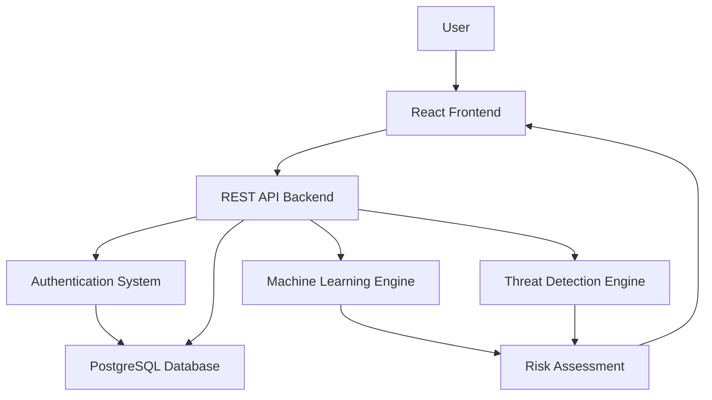

# 🛡️ ScamShield AI
## 🌐 Live Demo

🚀 **ScamShield AI is live!**

[![Live Demo] (https://scamshieldchecker.netlify.app/)

**Live Project:** https://scamshieldchecker.netlify.app/

Explore the AI-powered fraud detection platform, create your personal account, analyze suspicious messages and URLs, and access your personalized threat intelligence dashboard.
### Think Before You Click — Intelligent Digital Fraud Detection


## 📌 Project Overview

ScamShield AI is a full-stack, AI-powered cybersecurity platform designed to identify potential digital scams, phishing attempts, fraudulent messages, suspicious emails, and malicious URL indicators.

The platform combines Machine Learning, Natural Language Processing (NLP), and rule-based threat detection to provide explainable risk assessments and actionable cybersecurity recommendations.

ScamShield AI provides a secure multi-user environment where individuals can create accounts, manage personal profiles, analyze suspicious content, and maintain private investigation histories through an interactive dashboard.

## 🎯 Problem Statement

With the rapid growth of digital transactions, online communication, and internet services, cybercrime has become a significant concern. Individuals frequently encounter phishing emails, fraudulent payment requests, fake job offers, identity theft attempts, and social engineering attacks.

ScamShield AI aims to reduce these risks by providing an accessible and intelligent platform that helps users identify potential threats before taking action.

## ✨ Key Features

### 🤖 AI-Powered Fraud Detection

- SMS and WhatsApp scam detection
- Email phishing analysis
- Suspicious URL analysis
- Natural Language Processing
- Machine learning-based spam classification
- Explainable risk assessment
- Intelligent cybersecurity recommendations

### 🔐 Secure Multi-User Authentication

- Individual account registration and login
- Secure password hashing
- Protected backend APIs
- Session-based authentication
- Private user profiles
- Password management
- Account deletion
- User-specific data isolation

### 📊 Threat Intelligence Dashboard

- Interactive risk analytics
- Low, medium, and high-risk classifications
- Personal scan history
- Batch threat analysis
- Machine learning performance insights
- CSV and JSON report exports
- Real-time analysis results

### 🎨 User Experience

- Premium dark SaaS interface
- Responsive dashboard
- Mobile-friendly design
- Interactive data visualizations
- Intuitive navigation
- Personalized user experience

## 🛠️ Technology Stack

| Component | Technology |
|---|---|
| Frontend | React.js, JavaScript, HTML5, CSS3 |
| Backend | Node.js, JavaScript |
| Database | PostgreSQL |
| Machine Learning | TF-IDF, Logistic Regression |
| Model Development | Python, Scikit-learn |
| Authentication | Secure session-based authentication |
| API Architecture | REST APIs |
| Deployment Architecture | Serverless Functions |
| Version Control | Git and GitHub |

## 🧠 Machine Learning Methodology

ScamShield AI utilizes a hybrid detection approach that combines machine learning predictions with rule-based cybersecurity analysis.

1. **Data Preprocessing:** Processes and normalizes user-provided text.
2. **Feature Extraction:** Converts textual information into numerical features using TF-IDF vectorization.
3. **Classification:** Uses a trained Logistic Regression model to identify potential spam patterns.
4. **Threat Analysis:** Identifies suspicious keywords, urgency indicators, impersonation attempts, and URL patterns.
5. **Risk Assessment:** Generates an explainable risk score ranging from 0 to 100.
6. **Recommendations:** Provides preventive measures based on the identified threat indicators.

### Risk Classification

| Risk Level | Description |
|---|---|
| 🟢 Low Risk | Limited suspicious indicators detected |
| 🟡 Medium Risk | Potentially suspicious content requiring verification |
| 🔴 High Risk | Significant indicators of potential fraud |

## 🏗️ System Architecture



## 📁 Project Structure

```text
ScamShield-AI/
├── frontend/
│   ├── src/
│   ├── index.html
│   └── login.html
├── server/
├── netlify/
│   ├── functions/
│   └── database/
├── ml/
├── data/
├── tests/
├── package.json
├── netlify.toml
├── TEST_REPORT.md
└── README.md
```

## 🗄️ Database Management

The application uses PostgreSQL to manage persistent user accounts, authentication sessions, and private scan history.

### Database Entities

- **Users:** Stores account information and securely hashed passwords.
- **Sessions:** Manages authenticated user sessions.
- **Scans:** Stores user-specific threat analysis records.

Each user's records are associated with a unique user ID to prevent unauthorized access by other application users.

## 🔒 Security and Privacy

ScamShield AI incorporates multiple security mechanisms to protect user information:

- Secure password hashing
- Server-side authorization
- Protected API endpoints
- Parameterized database queries
- Secure session cookies
- Cross-origin request protection
- Request rate limiting
- User-specific access controls
- Session invalidation
- Restricted access to database credentials

Sensitive credentials are not intended to be exposed in the public source code.

## 🚀 Getting Started

### Prerequisites

- Node.js
- npm
- Git
- Compatible PostgreSQL database environment

### Installation

Clone the repository:

```bash
git clone <YOUR_REPOSITORY_URL>
```

Navigate to the project directory:

```bash
cd ScamShield-AI
```

Install dependencies:

```bash
npm install
```

Run the build command:

```bash
npm run build
```

Run the automated tests:

```bash
npm test
```

The project includes serverless deployment configuration and database initialization files. A compatible runtime and database connection are required for full authentication and backend functionality.

## 🧪 Testing and Validation

The application has undergone local regression testing covering:

- User registration and authentication
- Password security
- Cross-user data isolation
- Fraud detection
- Batch scanning
- Scan history management
- Risk analytics
- Report exports
- Account management and deletion

Six local regression test groups passed using the local database test adapter. Live PostgreSQL integration and production deployment require separate verification.

## 🌍 Real-World Applications

- Personal cybersecurity
- Digital payment fraud awareness
- Banking and financial security
- Enterprise phishing awareness
- Online shopping safety
- Educational cybersecurity initiatives
- Social engineering threat identification

## 🔮 Future Enhancements

- Real-time threat intelligence integration
- Multilingual scam detection
- Browser extension
- Android and iOS applications
- QR code fraud detection
- Email verification
- Multi-factor authentication
- Deep learning-based fraud classification
- Voice scam detection
- Advanced malicious domain reputation analysis

## 🎓 Academic Significance

This project demonstrates the practical integration of Artificial Intelligence, Machine Learning, Natural Language Processing, Cybersecurity, Full-Stack Development, Database Management, and Cloud Computing.

It focuses on solving a real-world problem through intelligent automation and secure software engineering practices.

## ⚠️ Disclaimer

ScamShield AI is an educational and cybersecurity awareness project. Its predictions are based on machine learning and heuristic analysis and do not guarantee the detection of every fraudulent activity.

The demonstration model uses synthetic training data, and its real-world fraud detection accuracy has not been independently validated.

Users should independently verify suspicious communications before sharing personal information or completing financial transactions.

## 👨‍💻 Developer

**Developed as a B.Tech Computer Science and Engineering — Artificial Intelligence and Machine Learning project.**

## ⭐ Support

If you find this project useful, consider giving the repository a star and sharing it with others interested in Artificial Intelligence and Cybersecurity.

---

**ScamShield AI — Detect. Protect. Prevent.**

*Building a safer digital future through Artificial Intelligence.*
